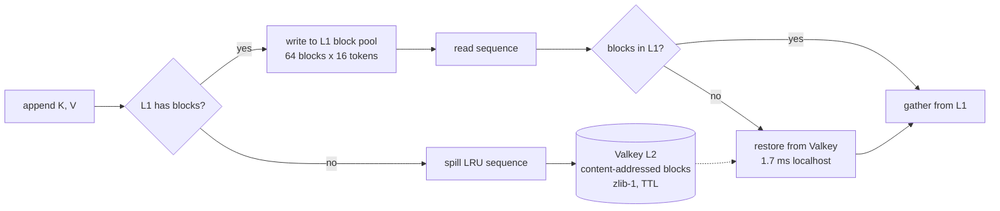

# valkey-kv-l2

A Valkey-backed L2 for an LLM KV cache. With a fixed 64-block L1, 4 of 200
sequences completed; with the L2 behind it, all 200 did. Restoring a prefix
beats recomputing it above roughly 4k tokens.

L1 is a fixed block pool. When it fills, the least recently used sequence
spills to Valkey and is restored on its next read. Blocks are content-addressed
(sha256 over the K and V bytes), so a restored sequence can hit an entry written
by another sequence or by a previous process.



When a fixed KV pool fills, new requests are refused even if most resident KV
belongs to finished requests. Spilling to a shared store replaces that refusal
with a restore cost. Restore cost is compared against prefill, the work it
replaces.

## Results

64-block L1, block size 16, dim 64; 200 sequences of 32–400 tokens, 44,166
tokens total, 43x more KV than L1 can hold.

| Metric | Value |
|---|---|
| Sequences served, fixed pool | **4 of 200 (2%)** |
| Sequences served, tiered | **200 of 200 (100%)** |
| L2 hit rate on restore | **1.00** |
| Mean restore time | **1.7 ms** (localhost) |
| Valkey memory holding 44k tokens | **60 MB** |
| Bytes written to Valkey | 49.7 MB |

Restore versus recompute, Qwen3-4B f16 KV (144 KiB/token), same machine:

| prefix tokens | prefill | restore from Valkey | prefill / restore |
|---:|---:|---:|---:|
| 512 | 100 ms | 104 ms | 0.97 |
| 2,048 | 373 ms | 416 ms | 0.90 |
| 4,096 | 810 ms | 783 ms | 1.03 |
| 6,144 | 1,310 ms | 1,025 ms | **1.28** |

Break-even is around 4k tokens. Below it, the round trip and transfer cost more
than recomputing. Above it, restore wins because prefill cost rises with context
while restore scales with the bytes transferred.

An external KV store pays when the model is large, the prefix is long, or the
KV is quantized. On this 4B model with 512-token prompts, it is slower than
recomputing.

Method and sensitivity are in
[`docs/kv-offload-crossover.md`](docs/kv-offload-crossover.md); the chart is in
[`docs/restore-vs-prefill.svg`](docs/restore-vs-prefill.svg).

## Quick start

Nix provides the store, Python with numpy, and make. The benchmark starts and
stops its own Valkey if none is listening.

```bash
nix develop
make bench
```

That runs the lossless round-trip and tiering tests, the capacity benchmark, and
re-renders the chart from the committed sweep. To verify the committed chart
matches the committed results:

```bash
make check
```

The crossover numbers need a `llama-server` on `:8097`:

```bash
make bench-restore LLAMA_URL=http://127.0.0.1:8097
```

`make help` lists every target. `nix flake check` runs the tests and the chart
freshness check.

## What is implemented

- `src/resp.py` — RESP client, stdlib sockets only. PING, SET with EX, GET, DEL,
  EXISTS, DBSIZE, INFO.
- `src/l2.py` — content-addressed block store. sha256 over K and V bytes, zlib
  level 1, TTL, hit/miss and byte counters.
- `src/tiered.py` — tiering policy. Reserves blocks for a whole append before
  writing, spills LRU sequences, restores on read, spills again if a restore
  itself needs space.
- `bench/bench.py` — capacity benchmark. `bench/sweep.py` and
  `bench/restore_vs_prefill.py` — restore versus prefill.
- `bench/chart.py` — the SVG chart, stdlib only and deterministic, so the
  committed file can be diffed.

## Correctness

A restored sequence must match the spilled sequence; otherwise the cache
corrupts inference.

```
$ make test
ok   encode/decode is lossless
ok   low-entropy blocks compress (127 < 2048)
ok   random blocks stay within framing overhead
ok   keys are content-addressed
ok   valkey responds to PING
ok   block written to valkey
ok   block restored byte-identical
ok   block removed
ok   a sequence spilled under block pressure
ok   restored sequence is identical to the pre-spill one
ok   restore produced L2 hits
ok   tiering served 20 sequences with only 8 blocks
all passed (0 failure(s))
```

## Scope

Block-level caching for a reference KV stack, not a drop-in for a production
serving engine. No eviction TTL tuning, no compression benchmarking beyond
lossless round-trip, no cluster mode. The 1.7 ms restore is localhost.

## License

MIT
