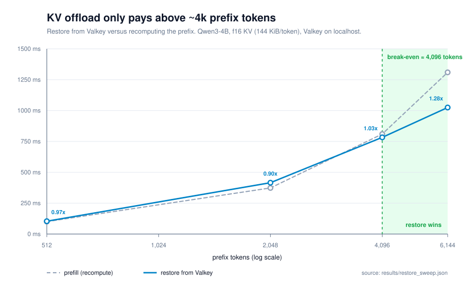

# KV offload only pays above 4k tokens

A fixed KV pool turns concurrency into a cliff: the moment every block is
resident, the server refuses new sequences even though most of the resident KV
belongs to requests nobody is reading. Spilling the least recently used
sequence to Valkey removes the cliff. In the capacity benchmark it takes the
pool from **4 of 200 sequences served to 200 of 200**, for 60 MB of shared
memory and a 1.7 ms restore.

That compares tiering against refusing work. The real alternative to a restore
is a **prefill**, so both were measured at the same prefix lengths on the same
machine. The result is the crossover, not the capacity number: **restore only
beats recomputing above roughly 4k prefix tokens**, and below 2k it is strictly
worse than not caching at all.



## Method

Capacity run:

- 64-block L1, block size 16, dim 64.
- 200 sequences of 32–400 tokens, 44,166 tokens total, 43x more KV than L1 can
  hold.
- Baseline refuses a sequence when the pool is exhausted. Tiered spills the LRU
  sequence and restores it on the next read.
- Blocks are content-addressed (sha256 over K and V bytes), so a restored
  sequence can hit an entry written by a different sequence or a previous
  process.

Crossover run:

- `Qwen3-4B-Instruct-2507`, 36 layers, 8 KV heads, head dim 128, f16 KV =
  **147,456 bytes per token (144 KiB)**. Geometry is read from the model
  definition, not assumed.
- **Prefill**: `llama-server` on Vulkan, `/v1/completions` with `max_tokens=1`
  and `cache_prompt=false`, so every request pays a real prefill. `prompt_ms`
  comes from the server's timings, not from wall clock.
- **Restore**: the same number of bytes that N tokens of KV occupy, written to
  Valkey as 16-token blocks, then read back through the same RESP client the
  tiering path uses. The measurement is GET plus deserialization, which is what
  a cache miss costs.
- Four prefix lengths, repeated three times, median reported. The first request
  after model load is discarded: on this Vulkan build it costs about 3x the
  steady-state prefill while shaders and graphs are set up.

Reference run: i7-10700K, RX 9070 XT (Vulkan), 31 GiB RAM, Valkey 9.1, Python
3.14. Committed artifacts are `results/valkey_l2.json` and
`results/restore_sweep.json`.

## Results

Capacity:

| | fixed pool | tiered |
|---|---:|---:|
| sequences served | **4 of 200 (2%)** | **200 of 200 (100%)** |
| L2 hit rate on restore | — | **1.00** |
| spills / restores | — | 246 / 50 |
| Valkey memory for 44k tokens | — | **60 MB** |
| bytes written to Valkey | — | 49.7 MB |
| mean restore | — | **1.7 ms** (localhost) |

Restore versus prefill:

| prefix tokens | prefill | restore | prefill / restore |
|---:|---:|---:|---:|
| 512 | 100 ms | 104 ms | 0.97 |
| 2,048 | 373 ms | 416 ms | 0.90 |
| 4,096 | 810 ms | 783 ms | 1.03 |
| 6,144 | 1,310 ms | 1,025 ms | **1.28** |

At 512 tokens the restore loses. At 2k it loses by 10%. At 4k the two are
within noise of each other. By 6k the restore wins by 28%, and the gap widens
with length.

## Why the crossover exists

A restore costs bytes: `tokens x 144 KiB`, moved over the socket and
decompressed. At 6,144 tokens that is 864 MiB, read at roughly 840 MiB/s on
loopback.

A prefill costs compute, and the per-token cost rises with the prefix because
attention work grows with context. At 512 tokens prefill takes 100 ms; at 6,144
it takes 1,310 ms, which is 12x the tokens for 13x the time on this model. The
restore curve is flatter because after a fixed overhead it only pays for bytes.

So the cache is a **bandwidth bet**: it wins when the bytes are cheap relative
to the compute they replace. That means a large model, a long prefix, or KV
that has been quantized so the bytes shrink. On a 4B model with 512-token
prompts, an external KV store is a pessimisation.

## What would move the crossover

- **Network RTT.** The 1.7 ms restore is localhost with no round trip. A 1 ms
  RTT adds about 30% to a 4k restore and pushes the crossover right.
- **KV quantization.** `q8_0` halves the bytes per token, which almost halves
  restore time. The crossover moves left.
- **Batch size.** A prefill is shared across a batch; a restore is per
  sequence. At batch > 1 the recompute side gets cheaper relative to the
  restore side.
- **Model size.** KV bytes per token grow with layers and KV heads, and prefill
  FLOPs grow with parameters. Which side wins depends on the ratio, which is
  why it is measured per model rather than assumed.
- **Compression.** The store compresses with zlib level 1. A different codec
  changes bytes on the wire, not the shape of the result.

## Measurement noise

The restore side is bandwidth-bound, so a busy machine moves it. During one
re-run with a compiler running in the background, the 6,144-token restore went
from 1.0 s to 4.3 s while prefill stayed within 5% of its reference value. The
prefill side is compute-bound and far more stable.

`sweep.py` now discards a warm-up request and reports the median of three runs
per point, and the committed JSON is a reference run on a quiet machine. If you
re-run it, run it on an idle box and commit what you get.

## Limits

- This is a reference KV stack, not a serving deployment. No GPU concurrency
  numbers, no production traffic.
- The restore path moves random bytes of the right size. It measures transfer
  and deserialization, not the attention math a real restore would preserve.
- Localhost only. No network model.
- One machine, one model, one block size.
- The capacity benchmark uses a small synthetic KV (dim 64) to exercise the
  policy. It is a policy test, not a memory-bandwidth test.

## Reproduce

```bash
nix develop

# tests, capacity benchmark, chart from the committed sweep
make bench

# verify the committed chart matches the committed results
make check
```

The crossover numbers need a model server on `:8097`:

```bash
llama-server -m ~/models/Qwen3-4B-Instruct-2507-Q4_K_M.gguf \
  --alias qwen3-4b --host 127.0.0.1 --port 8097 \
  --ctx-size 8192 --parallel 1 --n-gpu-layers 99 \
  -ctk f16 -ctv f16 --reasoning off

make bench-restore
```

`make bench-restore` rewrites `results/restore_sweep.json` and re-renders the
chart. `make chart` re-renders without re-measuring.
